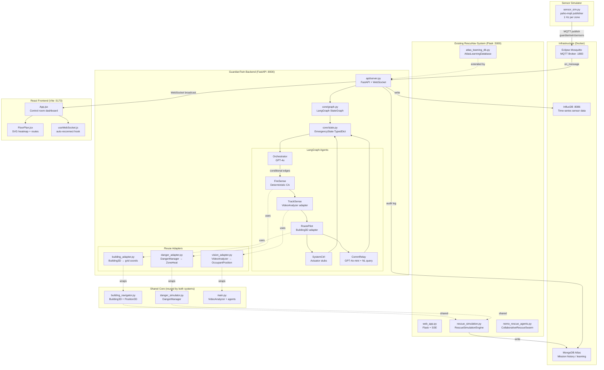
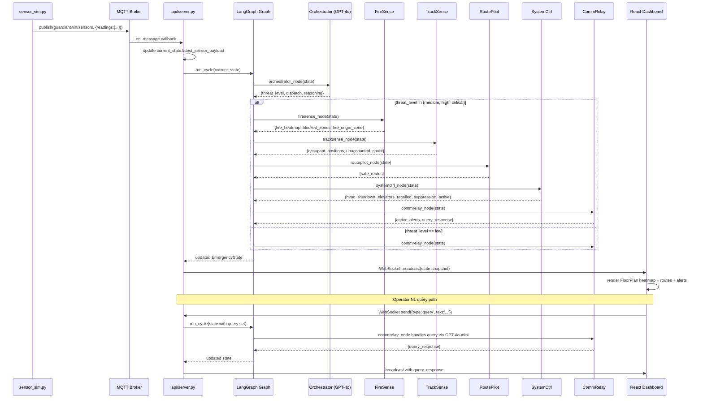
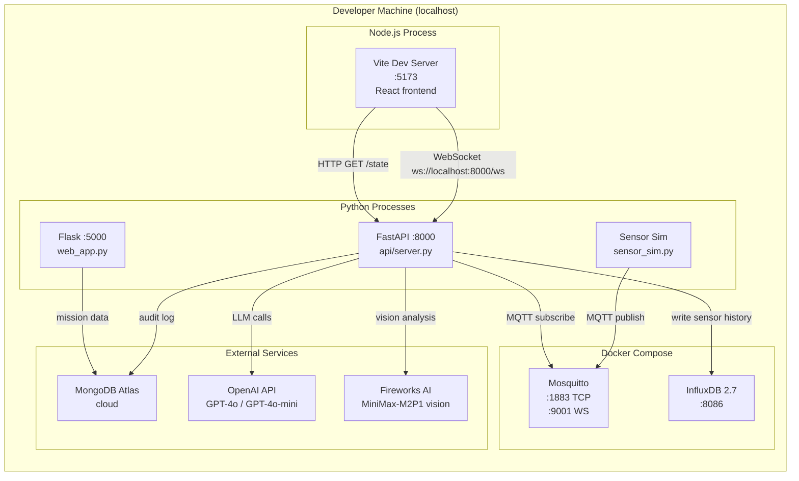

# Design Document: GuardianTwin Integration

## Overview

GuardianTwin is a multi-agent AIoT emergency response system built on top of the existing RescuNav rescue simulation project. The integration reuses the existing 3D building model, A* pathfinder, danger simulation, and vision AI pipeline, while adding a LangGraph orchestration layer, MQTT sensor simulation, FastAPI/WebSocket real-time server, and a React control room dashboard. The result is a live digital twin that autonomously detects fire, tracks occupants, computes evacuation routes, and controls building systems — all observable in real time by an operator.

The existing Flask web app and rescue simulation engine are preserved as a parallel subsystem. GuardianTwin runs as a new FastAPI service alongside it, sharing the building model and danger simulation logic through adapter modules rather than forking the existing code.

---

## Architecture

### High-Level System Diagram



### Data Flow: MQTT → FastAPI → LangGraph → WebSocket → React



---

## Component Map: Reused / New / Replaced

| Component | Status | Notes |
|---|---|---|
| `building_navigator.py` `Building3D` | **REUSED** | Wrapped by `building_adapter.py`. Grid is 20×20 per floor — exact match. |
| `building_navigator.py` `Position3D` | **REUSED** | Maps to `OccupantPosition.grid_x/grid_y` via adapter. |
| `danger_simulator.py` `DangerManager` | **REUSED** | Wrapped by `danger_adapter.py`. Provides fire + attacker zones to FireSense. |
| `danger_simulator.py` `FireSimulator` | **REUSED** | Existing spread logic augments the new cellular automata model. |
| `main.py` `VideoAnalyzer` | **REUSED** | Wrapped by `vision_adapter.py`. Fireworks AI vision → `OccupantPosition` list. |
| `main.py` `ThreatDetector` / `PeopleDetector` | **REUSED** | Live vision backend for TrackSense when video is available. |
| `main.py` `PositionEstimator` | **REUSED** | 3D coords → grid_x/grid_y conversion in vision adapter. |
| `atlas_learning_db.py` | **EXTENDED** | New `store_guardian_cycle()` method logs GuardianTwin agent cycles. |
| `nemo_rescue_agents.py` | **PRESERVED** | Runs unchanged under Flask. Learning patterns inform CommRelay memory. |
| `rescue_simulation.py` | **PRESERVED** | Runs unchanged under Flask on port 5000. |
| `web_app.py` | **PRESERVED** | Flask SSE UI kept as-is. GuardianTwin adds FastAPI on port 8000. |
| `models/fire_spread.py` | **NEW** | Deterministic cellular automata heatmap. Runs alongside DangerManager. |
| `models/router.py` | **NEW** | Thin A* wrapper on 20×20 grid with fire cost weights. Delegates to `Building3D.find_path()` when possible. |
| `core/state.py` | **NEW** | `EmergencyState` TypedDict — extended with existing data structures. |
| `core/graph.py` | **NEW** | LangGraph `StateGraph` wiring all 6 nodes. |
| `agents/orchestrator.py` | **NEW** | GPT-4o threat assessment + dispatch. |
| `agents/firesense.py` | **NEW** | Calls `fire_spread.compute_heatmap()` + `danger_adapter`. |
| `agents/tracksense.py` | **NEW** | Calls `vision_adapter` (live) or stub JSON (fallback). |
| `agents/routepilot.py` | **NEW** | Calls `router.compute_routes()` backed by `Building3D`. |
| `agents/systemctrl.py` | **NEW** | Actuator stubs (HVAC, elevators, suppression). |
| `agents/commrelay.py` | **NEW** | GPT-4o-mini NL query + evacuation alerts. |
| `api/server.py` | **NEW** | FastAPI + WebSocket + MQTT listener. |
| `simulator/sensor_sim.py` | **NEW** | paho-mqtt publisher, 1 Hz, fire triggers at T+30s. |
| `frontend/` | **NEW** | React + Vite dashboard. Replaces nothing — Flask UI stays. |
| `docker-compose.yml` | **NEW** | MQTT broker + InfluxDB containers. |

---

## Infrastructure Topology



---

## Low-Level Design

### 1. Updated EmergencyState TypedDict (`core/state.py`)

The base `EmergencyState` from the MVP spec is extended with fields that carry existing system data through the LangGraph graph.

```python
# core/state.py
from typing import TypedDict, Literal, Optional, Annotated
from langgraph.graph.message import add_messages

class ZoneHeat(TypedDict):
    zone: str
    fire_prob: float           # 0.0–1.0 from cellular automata
    smoke_prob: float          # 0.0–1.0 from sensor ppm
    predicted_spread_mins: Optional[float]
    # Extended: danger level from existing DangerManager
    danger_manager_level: Optional[float]  # 0.0–1.0 from DangerZone.danger_level

class OccupantPosition(TypedDict):
    person_id: str
    zone: str                  # e.g. 'F3-B'
    grid_x: int                # 0–19
    grid_y: int                # 0–19
    floor: int                 # 0–3 (maps to Building3D floor index)
    status: Literal['safe', 'at_risk', 'unknown']
    last_seen: float           # unix timestamp
    # Extended: 3D coords from existing PositionEstimator
    coords_3d: Optional[list]  # [x, y, z] in meters from VideoAnalyzer
    danger_level: Optional[str]  # 'low'|'medium'|'high'|'critical' from PeopleDetector

class RouteWaypoint(TypedDict):
    grid_x: int
    grid_y: int
    zone: str

class EmergencyState(TypedDict):
    # Sensor data
    latest_sensor_payload: dict
    sensor_history: list[dict]
    # Fire state
    fire_heatmap: dict[str, ZoneHeat]
    fire_origin_zone: Optional[str]
    fire_detected_at: Optional[float]
    # Occupant tracking
    occupant_positions: list[OccupantPosition]
    total_registered_occupants: int
    unaccounted_count: int
    # Routing
    safe_routes: dict[str, list[RouteWaypoint]]
    blocked_zones: list[str]
    # Building systems
    hvac_shutdown: bool
    elevators_recalled: bool
    suppression_active: list[str]
    emergency_lighting: bool
    # Status
    threat_level: Literal['none', 'low', 'medium', 'high', 'critical']
    active_alerts: list[dict]
    agent_action_log: list[str]
    messages: Annotated[list, add_messages]
    # NL query
    query: Optional[str]
    query_response: Optional[str]
    # Extended: mission audit reference for atlas_learning_db
    current_mission_id: Optional[str]
    # Extended: raw vision analysis from VideoAnalyzer (when live video available)
    vision_analysis: Optional[dict]
```

---

### 2. Building3D → Zone Grid Mapping (`adapters/building_adapter.py`)

`Building3D` uses a 20×20 grid per floor with `Position3D(x, y, z, floor)`. The GuardianTwin zone system uses string labels like `F3-B` mapped to 5×5 cell regions on the same 20×20 grid.

```
Zone layout on 20×20 grid (rows 0–19, cols 0–19):
  cols 0–4   cols 5–9   cols 10–14  cols 15–19
  ┌──────────┬──────────┬───────────┬──────────┐
  │  F3-A    │  F3-B    │  F3-C     │  F3-D    │  rows 0–4   (floor 3 in Building3D)
  ├──────────┼──────────┼───────────┼──────────┤
  │  F2-A    │  F2-B    │  F2-C     │  F2-D    │  rows 5–9   (floor 2)
  ├──────────┼──────────┼───────────┼──────────┤
  │  F1-A    │  F1-B    │  F1-C     │  F1-D    │  rows 10–14 (floor 1)
  └──────────┴──────────┴───────────┴──────────┘
  (rows 15–19 = ground floor exits, not named zones)

Building3D floor index:  0=ground, 1=floor1, 2=floor2, 3=floor3
Zone floor label:        F1=floor1, F2=floor2, F3=floor3
Mapping: zone_floor = int(zone[1]) → building_floor = zone_floor (1-indexed matches)
```

```python
# adapters/building_adapter.py
from building_navigator import Building3D, Position3D
from core.state import OccupantPosition, RouteWaypoint
from typing import Optional

ZONE_TO_REGION = {
    'F3-A': (0, 0),  'F3-B': (0, 5),  'F3-C': (0, 10), 'F3-D': (0, 15),
    'F2-A': (5, 0),  'F2-B': (5, 5),  'F2-C': (5, 10), 'F2-D': (5, 15),
    'F1-A': (10, 0), 'F1-B': (10, 5), 'F1-C': (10, 10),'F1-D': (10, 15),
}

ZONE_FLOOR = {'F1': 1, 'F2': 2, 'F3': 3}

def zone_to_position3d(zone: str, grid_x: int, grid_y: int,
                        building: Building3D) -> Optional[Position3D]:
    """Convert zone label + grid coords to Building3D Position3D."""
    floor_label = zone[:2]
    floor = ZONE_FLOOR.get(floor_label, 1)
    x = float(grid_x) * building.cell_size
    y = float(grid_y) * building.cell_size
    z = float(floor) * building.floor_height
    return Position3D(x=x, y=y, z=z, floor=floor)

def position3d_to_zone(pos: Position3D) -> str:
    """Convert Building3D Position3D to zone label."""
    col_idx = min(int(pos.x / 5.0), 3)
    zone_letter = ['A', 'B', 'C', 'D'][col_idx]
    return f'F{pos.floor}-{zone_letter}'

def find_safe_route_via_building3d(
    occupant: OccupantPosition,
    blocked_zones: list[str],
    building: Building3D
) -> Optional[list[RouteWaypoint]]:
    """
    Use Building3D.find_path() (NetworkX A* with danger avoidance)
    to compute an evacuation route for one occupant.

    Preconditions:
    - occupant.zone is a valid zone label
    - building is initialized with danger zones already updated
    Postconditions:
    - Returns list of RouteWaypoint or None if no path found
    - Each waypoint has grid_x, grid_y, zone populated
    """
    start = zone_to_position3d(occupant['zone'], occupant['grid_x'],
                                occupant['grid_y'], building)
    if start is None:
        return None
    # Use nearest exit as goal
    if not building.exits:
        return None
    goal = min(building.exits, key=lambda e: start.distance_to(e))
    path = building.find_path(start, goal, avoid_danger=True)
    if not path:
        return None
    return [
        RouteWaypoint(
            grid_x=int(p.x / building.cell_size),
            grid_y=int(p.y / building.cell_size),
            zone=position3d_to_zone(p)
        )
        for p in path
    ]
```

---

### 3. FireSense ↔ DangerManager Integration (`adapters/danger_adapter.py`)

FireSense runs the new cellular automata model AND queries the existing `DangerManager` to merge both fire probability sources.

```python
# adapters/danger_adapter.py
from danger_simulator import DangerManager, DangerZone
from building_navigator import Building3D, Position3D
from core.state import ZoneHeat
from adapters.building_adapter import ZONE_TO_REGION, position3d_to_zone

def danger_zones_to_heatmap_overlay(
    danger_manager: DangerManager,
    building: Building3D
) -> dict[str, float]:
    """
    Convert DangerManager fire zones to a zone→danger_level dict.
    Used by firesense_node to augment the cellular automata heatmap.

    Preconditions:
    - danger_manager has been updated for current simulation time
    Postconditions:
    - Returns dict mapping zone labels to max danger level (0.0–1.0)
    - Only fire-type zones are included (attacker zones excluded)
    """
    overlay: dict[str, float] = {}
    for zone in danger_manager.get_all_danger_zones():
        if zone.type != 'fire':
            continue
        zone_label = position3d_to_zone(zone.position)
        current = overlay.get(zone_label, 0.0)
        overlay[zone_label] = max(current, zone.danger_level)
    return overlay

def update_building_from_heatmap(
    heatmap: dict[str, ZoneHeat],
    building: Building3D
):
    """
    Push GuardianTwin fire heatmap back into Building3D danger zones
    so that Building3D.find_path() uses current fire data.

    Preconditions:
    - heatmap contains ZoneHeat entries with fire_prob values
    Postconditions:
    - building.nodes danger_level values reflect current fire_prob
    - Existing danger zones are reset before applying new values
    """
    danger_list = []
    for zone_label, heat in heatmap.items():
        region = ZONE_TO_REGION.get(zone_label)
        if region is None:
            continue
        row, col = region
        # Use center of zone region as the danger position
        center_x = float(col + 2) * building.cell_size
        center_y = float(row + 2) * building.cell_size
        floor_num = int(zone_label[1])
        pos = Position3D(
            x=center_x, y=center_y,
            z=float(floor_num) * building.floor_height,
            floor=floor_num
        )
        danger_list.append((pos, heat['fire_prob']))
    building.update_danger_zones(danger_list)
```

---

### 4. TrackSense ↔ VideoAnalyzer Integration (`adapters/vision_adapter.py`)

TrackSense uses the existing `VideoAnalyzer` when a video source is available, falling back to stub JSON otherwise.

```python
# adapters/vision_adapter.py
import json, os, time
from typing import Optional
from core.state import OccupantPosition
from adapters.building_adapter import ZONE_FLOOR

def _pixel_to_grid(px: int, py: int, frame_w: int, frame_h: int) -> tuple[int, int]:
    """Map pixel coords to 20×20 grid coords."""
    gx = min(19, int(px / frame_w * 20))
    gy = min(19, int(py / frame_h * 20))
    return gx, gy

def _grid_to_zone(gx: int, gy: int) -> str:
    """Map grid coords to zone label."""
    floor = 3 - gy // 5  # rows 0–4 = F3, 5–9 = F2, 10–14 = F1
    floor = max(1, min(3, floor))
    col = min(3, gx // 5)
    return f'F{floor}-{["A","B","C","D"][col]}'

def video_analysis_to_occupants(
    people_data: dict,
    position_data: dict,
    blocked_zones: list[str]
) -> list[OccupantPosition]:
    """
    Convert VideoAnalyzer output (PeopleDetector + PositionEstimator)
    to OccupantPosition list for EmergencyState.

    Preconditions:
    - people_data has 'people' list with id, position [x,y,w,h], danger_level
    - position_data has 'positions' list with id, coords [x,y,z], floor
    Postconditions:
    - Returns OccupantPosition list with zone, grid_x, grid_y populated
    - status set to 'at_risk' if person's zone is in blocked_zones
    """
    occupants = []
    for person in people_data.get('people', []):
        pid = str(person['id'])
        bbox = person.get('position', [0, 0, 100, 100])
        cx = bbox[0] + bbox[2] // 2
        cy = bbox[1] + bbox[3] // 2
        # Assume 1280×720 frame if not known
        gx, gy = _pixel_to_grid(cx, cy, 1280, 720)
        zone = _grid_to_zone(gx, gy)

        # Try to get floor from PositionEstimator
        pos_3d = next(
            (p for p in position_data.get('positions', [])
             if str(p.get('id')) == f'person_{pid}'),
            None
        )
        floor = pos_3d['floor'] if pos_3d else int(zone[1])
        coords_3d = pos_3d['coords'] if pos_3d else None

        status: str = 'at_risk' if zone in blocked_zones else 'unknown'

        occupants.append(OccupantPosition(
            person_id=f'P{pid}',
            zone=zone,
            grid_x=gx,
            grid_y=gy,
            floor=floor,
            status=status,
            last_seen=time.time(),
            coords_3d=coords_3d,
            danger_level=person.get('danger_level', 'unknown')
        ))
    return occupants

def load_stub_occupants(stub_path: str, blocked_zones: list[str]) -> list[OccupantPosition]:
    """Load stub occupant_positions.json and apply current blocked zones."""
    with open(stub_path) as f:
        positions = json.load(f)
    for p in positions:
        p['last_seen'] = time.time()
        p.setdefault('floor', int(p['zone'][1]))
        p.setdefault('coords_3d', None)
        p.setdefault('danger_level', None)
        if p['zone'] in blocked_zones:
            p['status'] = 'at_risk'
    return positions
```

---

### 5. RoutePilot Agent — Building3D-Backed Router (`agents/routepilot.py`)

RoutePilot calls `compute_routes()` from `models/router.py`. The router first tries the lightweight grid A* (fast, <5ms), then falls back to `Building3D.find_path()` (NetworkX, more accurate) for complex paths.

```python
# agents/routepilot.py
from models.router import compute_routes as grid_astar_routes
from adapters.building_adapter import find_safe_route_via_building3d
from adapters.danger_adapter import update_building_from_heatmap

# building is a module-level singleton (initialized once at startup)
_building = None

def get_building():
    global _building
    if _building is None:
        from building_navigator import Building3D
        _building = Building3D()
    return _building

def routepilot_node(state: dict) -> dict:
    """
    Compute evacuation routes for all occupants.

    Preconditions:
    - state['occupant_positions'] is non-empty
    - state['fire_heatmap'] is populated by FireSense
    Postconditions:
    - state['safe_routes'] maps person_id → list[RouteWaypoint]
    - Routes avoid zones with fire_prob > 0.3
    - Falls back to Building3D A* if grid A* returns no path
    Loop invariants:
    - Each occupant is processed independently
    - Route cost is monotonically non-decreasing with fire_prob
    """
    occupants = state.get('occupant_positions', [])
    heatmap = state.get('fire_heatmap', {})
    log = list(state.get('agent_action_log', []))

    if not occupants or not heatmap:
        return {'agent_action_log': log + ['[RoutePilot] Waiting for data']}

    # Sync fire heatmap into Building3D danger zones for NetworkX A*
    building = get_building()
    update_building_from_heatmap(heatmap, building)

    # Try fast grid A* first
    routes = grid_astar_routes(occupants, heatmap)

    # For any occupant without a route, fall back to Building3D A*
    blocked = state.get('blocked_zones', [])
    for occ in occupants:
        pid = occ['person_id']
        if pid not in routes:
            fallback = find_safe_route_via_building3d(occ, blocked, building)
            if fallback:
                routes[pid] = fallback
                log.append(f'[RoutePilot] Used Building3D fallback for {pid}')

    log.append(f'[RoutePilot] Routes computed for {len(routes)} occupants')
    log.append(f'[RoutePilot] Route lengths: { {pid: len(r) for pid, r in routes.items()} }')
    return {'safe_routes': routes, 'agent_action_log': log}
```

---

### 6. FireSense Agent — Merged Heatmap (`agents/firesense.py`)

```python
# agents/firesense.py
from models.fire_spread import compute_heatmap, get_dangerous_zones
from adapters.danger_adapter import danger_zones_to_heatmap_overlay
import time

_danger_manager = None  # injected at startup via set_danger_manager()

def set_danger_manager(dm):
    global _danger_manager
    _danger_manager = dm

def firesense_node(state: dict) -> dict:
    """
    Compute merged fire heatmap from:
    1. Cellular automata on MQTT sensor readings
    2. DangerManager fire zones (existing simulation)

    Preconditions:
    - state['latest_sensor_payload'] has 'readings' list
    Postconditions:
    - state['fire_heatmap'] has ZoneHeat for every zone with fire_prob > 0
    - state['blocked_zones'] lists zones with fire_prob >= 0.3
    - fire_prob is max(ca_prob, danger_manager_level) per zone
    """
    readings = state.get('latest_sensor_payload', {}).get('readings', [])
    prev_heatmap = state.get('fire_heatmap', {})

    # Step 1: cellular automata heatmap from sensor readings
    heatmap = compute_heatmap(readings, prev_heatmap)

    # Step 2: merge DangerManager overlay (existing simulation data)
    if _danger_manager is not None:
        overlay = danger_zones_to_heatmap_overlay(_danger_manager, None)
        for zone, dm_level in overlay.items():
            if zone in heatmap:
                merged_prob = max(heatmap[zone]['fire_prob'], dm_level)
                heatmap[zone] = {**heatmap[zone],
                                 'fire_prob': round(merged_prob, 3),
                                 'danger_manager_level': dm_level}
            else:
                heatmap[zone] = {
                    'zone': zone, 'fire_prob': round(dm_level, 3),
                    'smoke_prob': 0.0, 'predicted_spread_mins': None,
                    'danger_manager_level': dm_level
                }

    dangerous = get_dangerous_zones(heatmap, 0.3)
    origin = max(heatmap, key=lambda z: heatmap[z]['fire_prob'], default=None) if heatmap else None
    detected_at = state.get('fire_detected_at') or (time.time() if dangerous else None)

    log = state['agent_action_log'] + [
        f'[FireSense] Heatmap updated. Dangerous: {dangerous}',
        f'[FireSense] Origin zone: {origin}'
    ]
    return {
        'fire_heatmap': heatmap,
        'fire_origin_zone': origin,
        'fire_detected_at': detected_at,
        'blocked_zones': dangerous,
        'agent_action_log': log
    }
```

---

### 7. TrackSense Agent — Live Vision or Stub (`agents/tracksense.py`)

```python
# agents/tracksense.py
import os, time
from adapters.vision_adapter import video_analysis_to_occupants, load_stub_occupants

STUB_PATH = os.path.join(os.path.dirname(__file__), '../data/occupant_positions.json')
_video_analyzer = None  # injected at startup if video source available

def set_video_analyzer(va):
    global _video_analyzer
    _video_analyzer = va

def tracksense_node(state: dict) -> dict:
    """
    Locate occupants using live VideoAnalyzer or stub JSON fallback.

    Preconditions:
    - state['blocked_zones'] is populated by FireSense
    Postconditions:
    - state['occupant_positions'] has OccupantPosition for each detected person
    - Occupants in blocked_zones have status='at_risk'
    - state['unaccounted_count'] = total_registered - len(positions)
    """
    blocked = state.get('blocked_zones', [])
    vision_data = state.get('vision_analysis')

    if vision_data and _video_analyzer is not None:
        # Live path: use VideoAnalyzer output already in state
        people_data = vision_data.get('people_data', {})
        position_data = vision_data.get('position_data', {})
        positions = video_analysis_to_occupants(people_data, position_data, blocked)
    else:
        # Stub path: load pre-defined occupant positions
        positions = load_stub_occupants(STUB_PATH, blocked)

    unaccounted = state.get('total_registered_occupants', 4) - len(positions)
    log = state['agent_action_log'] + [
        f'[TrackSense] Located {len(positions)} occupants. Unaccounted: {unaccounted}',
        f'[TrackSense] At risk: {[p["person_id"] for p in positions if p["status"] == "at_risk"]}'
    ]
    return {
        'occupant_positions': positions,
        'unaccounted_count': unaccounted,
        'agent_action_log': log
    }
```

---

### 8. FastAPI Server Structure (`api/server.py`)

Key design decisions:
- `threading.Lock` guards all `current_state` mutations (MQTT callback runs in a thread)
- `asyncio.run(broadcast(...))` is called from the MQTT thread — safe because FastAPI runs in a separate event loop
- InfluxDB writes are fire-and-forget (non-blocking)
- Atlas audit log is written asynchronously after each cycle

```python
# api/server.py — key structure (signatures only)

app = FastAPI(title='GuardianTwin API')

# Module-level singletons
current_state: EmergencyState = initial_state()
clients: list[WebSocket] = []
lock = threading.Lock()
building: Building3D = Building3D()          # shared with RoutePilot
danger_manager: DangerManager = None         # initialized at startup
influx_client = None                         # InfluxDB write client
atlas_db: AtlasLearningDatabase = None       # optional, graceful fallback

def on_mqtt_message(client, userdata, msg) -> None:
    """MQTT callback: parse payload, run agent cycle, broadcast."""
    # 1. Parse JSON payload
    # 2. Acquire lock, update current_state['latest_sensor_payload']
    # 3. Append to sensor_history (keep last 60)
    # 4. current_state = run_cycle(current_state)
    # 5. Release lock
    # 6. asyncio.run(broadcast(current_state))
    # 7. write_to_influxdb(payload)  # non-blocking

def start_mqtt() -> None:
    """Start MQTT client in daemon thread."""

async def broadcast(state: EmergencyState) -> None:
    """Send state snapshot to all connected WebSocket clients."""
    # Serialize subset of state to JSON
    # Send to each client, remove dead connections

@app.websocket('/ws')
async def ws_endpoint(websocket: WebSocket) -> None:
    """WebSocket endpoint: accept, add to clients, handle query messages."""
    # On receive: if msg['type'] == 'query', set state['query'], run_cycle, broadcast

@app.get('/state')
def get_state() -> dict:
    """REST fallback: return current state snapshot."""

@app.get('/health')
def health() -> dict:
    """Health check: returns status of MQTT, InfluxDB, MongoDB connections."""

@app.on_event('startup')
def startup() -> None:
    """Initialize DangerManager, inject into agents, start MQTT thread."""
    # 1. Initialize Building3D (shared singleton)
    # 2. Initialize DangerManager(building, scenario='fire')
    # 3. firesense.set_danger_manager(danger_manager)
    # 4. routepilot uses building singleton
    # 5. Start MQTT daemon thread
    # 6. Connect InfluxDB client
    # 7. Connect AtlasLearningDatabase (optional, log warning if unavailable)
```

---

### 9. LangGraph Graph Assembly (`core/graph.py`)

```python
# core/graph.py

def route_after_orchestrator(state: EmergencyState) -> str:
    """
    Conditional edge: determine dispatch path based on threat level.
    Returns: 'dispatch_all' | 'dispatch_comms' | 'done'
    """
    level = state.get('threat_level', 'none')
    if level in ('medium', 'high', 'critical'):
        return 'dispatch_all'
    if level == 'low':
        return 'dispatch_comms'
    return 'done'

def build_graph() -> CompiledGraph:
    """
    Assemble LangGraph StateGraph.

    Node execution order for dispatch_all:
      orchestrator → firesense → tracksense → routepilot → [systemctrl, commrelay] → END

    Note: routepilot has two outgoing edges (systemctrl AND commrelay).
    LangGraph executes both in parallel when both edges are present.
    For MVP simplicity, run sequentially: routepilot → systemctrl → commrelay → END
    """
    g = StateGraph(EmergencyState)
    g.add_node('orchestrator', orchestrator_node)
    g.add_node('firesense',    firesense_node)
    g.add_node('tracksense',   tracksense_node)
    g.add_node('routepilot',   routepilot_node)
    g.add_node('systemctrl',   systemctrl_node)
    g.add_node('commrelay',    commrelay_node)

    g.set_entry_point('orchestrator')
    g.add_conditional_edges('orchestrator', route_after_orchestrator, {
        'dispatch_all':   'firesense',
        'dispatch_comms': 'commrelay',
        'done':           END
    })
    g.add_edge('firesense',  'tracksense')
    g.add_edge('tracksense', 'routepilot')
    g.add_edge('routepilot', 'systemctrl')
    g.add_edge('systemctrl', 'commrelay')
    g.add_edge('commrelay',  END)
    return g.compile()
```

---

### 10. Merged Project Folder Structure

```
RescuNav-AI-main/                        ← existing project root
│
├── [EXISTING — unchanged]
│   ├── main.py                          # VideoAnalyzer + Fireworks AI agents
│   ├── building_navigator.py            # Building3D + Position3D
│   ├── danger_simulator.py              # DangerManager + FireSimulator
│   ├── nemo_rescue_agents.py            # CollaborativeRescueSwarm
│   ├── rescue_simulation.py             # RescueSimulationEngine
│   ├── atlas_learning_db.py             # AtlasLearningDatabase (extended)
│   ├── web_app.py                       # Flask :5000 (preserved)
│   ├── templates/index.html
│   ├── static/
│   └── scenario/
│
├── [NEW — GuardianTwin backend]
│   ├── backend/
│   │   ├── agents/
│   │   │   ├── __init__.py
│   │   │   ├── orchestrator.py
│   │   │   ├── firesense.py             # uses danger_adapter
│   │   │   ├── tracksense.py            # uses vision_adapter
│   │   │   ├── routepilot.py            # uses building_adapter + router
│   │   │   ├── systemctrl.py
│   │   │   └── commrelay.py
│   │   ├── adapters/                    ← integration bridge layer
│   │   │   ├── __init__.py
│   │   │   ├── building_adapter.py      # Building3D ↔ zone grid
│   │   │   ├── danger_adapter.py        # DangerManager ↔ ZoneHeat
│   │   │   └── vision_adapter.py        # VideoAnalyzer ↔ OccupantPosition
│   │   ├── core/
│   │   │   ├── __init__.py
│   │   │   ├── state.py                 # EmergencyState TypedDict (extended)
│   │   │   ├── graph.py                 # LangGraph StateGraph
│   │   │   └── tools.py                 # @tool functions (optional)
│   │   ├── models/
│   │   │   ├── fire_spread.py           # cellular automata
│   │   │   └── router.py               # grid A* (delegates to Building3D)
│   │   ├── simulator/
│   │   │   └── sensor_sim.py            # MQTT publisher
│   │   ├── api/
│   │   │   └── server.py               # FastAPI + WebSocket
│   │   ├── data/
│   │   │   └── occupant_positions.json  # stub tracking data
│   │   ├── requirements.txt
│   │   └── .env
│
├── [NEW — React frontend]
│   ├── frontend/
│   │   ├── src/
│   │   │   ├── App.jsx
│   │   │   ├── components/FloorPlan.jsx
│   │   │   └── hooks/useWebSocket.js
│   │   └── package.json
│
├── [NEW — infrastructure]
│   ├── docker-compose.yml               # MQTT + InfluxDB
│   └── mosquitto.conf
│
└── requirements_rescue.txt              # existing (unchanged)
```

**Python path note**: `backend/` modules import from the project root (`building_navigator`, `danger_simulator`, `main`, `atlas_learning_db`). Add the project root to `sys.path` in `backend/api/server.py`:

```python
import sys, os
sys.path.insert(0, os.path.dirname(os.path.dirname(os.path.dirname(__file__))))
```

---

### 11. AtlasLearningDatabase Extension

Add one method to `atlas_learning_db.py` to log GuardianTwin agent cycles without breaking existing rescue simulation usage:

```python
# atlas_learning_db.py — new method added to AtlasLearningDatabase

def store_guardian_cycle(self, cycle_data: dict) -> str:
    """
    Store one GuardianTwin agent cycle for audit and analysis.

    Args:
        cycle_data: {
            'cycle_id': str,
            'timestamp': float,
            'threat_level': str,
            'fire_origin_zone': str | None,
            'blocked_zones': list[str],
            'occupant_count': int,
            'unaccounted_count': int,
            'routes_computed': int,
            'hvac_shutdown': bool,
            'elevators_recalled': bool,
            'agent_action_log': list[str],
            'cycle_latency_ms': float
        }
    Returns: inserted document ID string
    """
    guardian_collection = self.db['guardian_cycles']
    result = guardian_collection.insert_one({
        **cycle_data,
        'stored_at': datetime.utcnow()
    })
    return str(result.inserted_id)
```

---

### 12. Error Handling Strategy

| Failure | Detection | Response |
|---|---|---|
| OpenAI API timeout | `try/except` around `llm.invoke()` | Return last known `threat_level`, log `[Orchestrator] LLM timeout, using cached state` |
| MQTT broker down | `paho` reconnect callback | `client.reconnect_delay_set(1, 30)` — auto-retry with backoff |
| MongoDB unavailable | `try/except` in `store_guardian_cycle()` | Log warning, continue without persistence |
| InfluxDB unavailable | `try/except` in write call | Log warning, skip write |
| Building3D path not found | `find_path()` returns `None` | RoutePilot logs `[RoutePilot] No path for {pid}`, omits from routes |
| WebSocket client disconnect | `WebSocketDisconnect` exception | Remove from `clients` list silently |
| `occupant_positions.json` missing | `FileNotFoundError` | Return empty list, log `[TrackSense] Stub file not found` |

---

### 13. Testing Strategy

**Unit tests** (pytest):
- `test_building_adapter.py`: `zone_to_position3d`, `position3d_to_zone` round-trip
- `test_danger_adapter.py`: `danger_zones_to_heatmap_overlay` with mock `DangerManager`
- `test_vision_adapter.py`: `video_analysis_to_occupants` with sample people/position dicts
- `test_fire_spread.py`: `compute_heatmap` spread propagation over 3 ticks
- `test_router.py`: `compute_routes` returns valid waypoints, avoids high-cost zones

**Integration tests**:
- `test_graph_cycle.py`: full `run_cycle()` with mock sensor payload, assert `threat_level` transitions
- `test_server_websocket.py`: FastAPI TestClient WebSocket, send query, assert `query_response` populated

**Property-based tests** (hypothesis):
- `zone_to_position3d(zone, gx, gy)` → `position3d_to_zone(result)` == zone for all valid inputs
- `compute_heatmap(readings)` fire_prob always in [0.0, 1.0]
- `compute_routes(occupants, heatmap)` never routes through zones with fire_prob == 1.0

**Demo smoke test** (manual):
- Start Docker, sensor_sim, server, frontend
- At T+30s: assert `threat_level` transitions to `high` within 5s
- Assert `fire_heatmap['F3-B']['fire_prob'] > 0.5`
- Assert `safe_routes` contains routes for P1 and P2
- Assert NL query returns non-empty `query_response`

---

### 14. Performance Targets (Hackathon MVP)

| Metric | Target | Implementation |
|---|---|---|
| Agent cycle latency | < 3s | GPT-4o-mini for all agents except Orchestrator |
| Fire heatmap refresh | 1 Hz | MQTT publish rate = 1s |
| Route computation | < 50ms | Grid A* on 20×20 = O(400) nodes |
| WebSocket broadcast | < 10ms | JSON serialization of state subset |
| Building3D init | ~2s (once) | Module-level singleton, initialized at startup |
| NL query response | < 4s | GPT-4o-mini with pre-built state summary |

---

### 15. Security Considerations (MVP Scope)

- All services run on `localhost` only — no external exposure
- OpenAI API key stored in `.env`, never committed (`.gitignore` entry required)
- MQTT broker runs with `allow_anonymous true` — acceptable for localhost demo
- No authentication on FastAPI endpoints — acceptable for hackathon demo
- MongoDB Atlas credentials in `.env` — existing pattern from rescue simulation

---

### 16. Dependencies

**New Python packages** (add to `backend/requirements.txt`):
```
langgraph==0.2.28
langchain==0.3.7
langchain-openai==0.2.5
fastapi==0.115.4
uvicorn[standard]==0.32.0
websockets==13.1
paho-mqtt==2.1.0
influxdb-client==1.45.0
python-dotenv==1.0.1
```

**Existing packages** (already in `requirements_rescue.txt`, reused):
```
opencv-python, numpy, pymongo, requests, python-dotenv, networkx
```

**New Node.js packages** (`frontend/package.json`):
```json
{
  "dependencies": { "react": "^18", "react-dom": "^18" },
  "devDependencies": { "@vitejs/plugin-react": "^4", "vite": "^5" }
}
```

**Docker images**:
- `eclipse-mosquitto:2.0`
- `influxdb:2.7`
